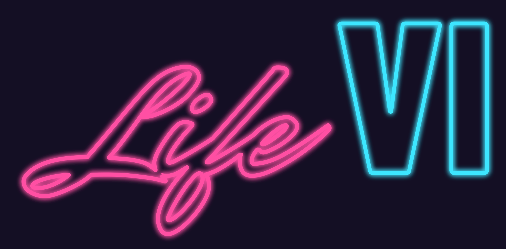
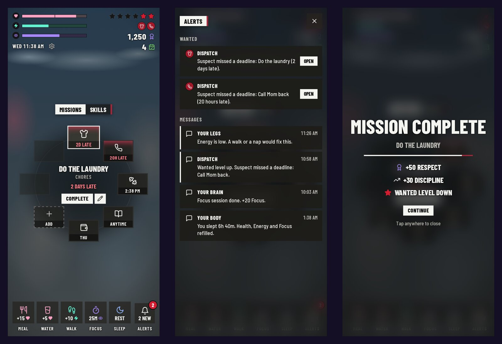

  

  
<strong>A free habit tracker that runs your real life like an open-world game HUD.</strong>

  

    
  

  

    
    
    
    
    
    
  

---

LIFE VI turns your day into a game screen. Three bars at the top (Health, Energy and Focus) drain as the hours go by, and you refill them by logging real things: meals, water, walks, focus sessions and sleep. Your to-dos become missions, and every mission that runs past its deadline adds a star to your wanted level until you finish it.

It runs in your phone's web browser. There's nothing to buy, no account to make, and no app store involved.

LIFE VI is in testing, which is why the version starts with 0. Expect changes, and keep a backup of your progress (see [Backups and new phones](#backups-and-new-phones)).

## Contents

- [Get it on your phone](#get-it-on-your-phone)
- [How to play](#how-to-play)
- [Your privacy](#your-privacy)
- [Backups and new phones](#backups-and-new-phones)
- [Questions](#questions)
- [For developers](#for-developers)
- [License](#license)

## Get it on your phone

The app lives at **[life-vi.xthrasherrr.dev](https://life-vi.xthrasherrr.dev/)**. Add it to your home screen so it opens full screen like any other app.

### iPhone

1. Open the link in **Safari**.
2. Tap the **Share** button (the square with an arrow pointing up).
3. Scroll down and tap **Add to Home Screen**, then **Add**.
4. Open LIFE VI from your home screen.

Adding it to your home screen also keeps your progress safe. Safari can delete a website's saved data if you don't visit it for about a week, but it leaves home screen apps alone.

### Android

1. Open the link in **Chrome**.
2. Tap **Install** if Chrome offers it. If not, open the menu (the three dots) and tap **Install app** or **Add to Home screen**.
3. Open LIFE VI from your home screen or app drawer.

### Computer

Open the link in any browser. It works there too, though it's made for phones.

## How to play

### Your bars

| Bar | Icon | Drains per hour | Refill it with |
|---|---|---|---|
| Health | Pink heart | 2 points | Meal (+15), Water (+5), sleep |
| Energy | Teal lightning bolt | 5 points | Walk (+10), sleep |
| Focus | Purple eye | 6 points | Focus session (+20), sleep |

The bars only drain while you're awake, and they keep going while the app is closed. A bar blinks when it drops below 25, and you get a message about it. If Energy reaches zero you're **burnt out**, and the only fix is to sleep it off.

### The buttons along the bottom

- **Meal, Water and Walk:** tap one when you do it.
- **Focus:** starts a 25-minute session. Focus stops draining while it runs, and you get +20 when it ends. You can close the app; the timer keeps counting. Tap Focus again to stop early, and you keep the share of the +20 you've earned so far.
- **Sleep:** tap it at bedtime, then tap **Wake up** in the morning. Eight hours refills Energy and Focus completely. If you forget to tap it, the app notices when you come back after 4 or more hours and asks whether you were asleep.
- **Alerts:** messages from Your Body, Your Brain, Dispatch and others. The red number shows how many you haven't read.

### Missions and your wanted level

- Tap the dashed **+** slot in the wheel to add a mission. Give it a name and an icon, and a deadline if it has one. Tick **Repeat every day** for habits like the gym.
- Tap a mission to select it. Tap **Complete** when it's done, or the pencil to change it.
- Each mission past its deadline adds a red star, up to six, plus a red badge with that mission's icon. Being awake between midnight and 5 AM adds a star too. Tap the stars to see why you're wanted.
- You can have 8 missions at a time. Finished one-time missions clear away the next day, and daily ones reset every morning.

### Respect, streak and skills

- **Respect** (purple number, top right) goes up by 50 every time you complete a mission.
- **Streak** (green number, top right) counts the days in a row you've completed at least one mission.
- **Skills** (the Skills tab) level up as you play. Stamina grows with walks, Sleep with nights of 7 hours or more, and Discipline with missions and focus sessions.

## Your privacy

- Everything you log stays on your phone, in your browser's own storage.
- There's no account, no ads, no analytics and no tracking. The app loads nothing from other websites.
- The app is hosted on GitHub Pages. Like every website host, GitHub keeps standard visit logs, such as your IP address. Your LIFE VI data is never sent to GitHub or anyone else.
- With no account, nobody can recover your data for you. Keep a backup.

## Backups and new phones

1. In LIFE VI, tap the gear next to the clock.
2. Tap **Download a backup** and save the file somewhere safe, like iCloud Drive or Google Drive, or email it to yourself.
3. On your new phone, open LIFE VI, tap the gear, then **Restore a backup** and pick that file.

Restoring replaces everything on that phone with the backup.

## Questions

**Does it cost anything?**
No. LIFE VI is free and open source.

**Is this made by Rockstar Games?**
No. It's a fan project, and it isn't affiliated with or endorsed by Rockstar Games or Take-Two Interactive.

**Why doesn't it count my steps or sleep by itself?**
Websites can't read Apple Health or Google's Health Connect. Only a store app can, so for now you tap to log.

**Will it send me notifications?**
Not yet. Alerts show up inside the app. A website can only notify you while it's closed if a server sends the message, and LIFE VI has no server, which is also why your data never leaves your phone.

**Does it work without internet?**
Yes, after you've opened it once.

**I lost my progress. Can I get it back?**
Only from a backup. Clearing your browser's history or website data deletes LIFE VI's data too.

**Something's broken, or I have an idea.**
[Open an issue](https://github.com/xThrasherrr/life-vi/issues) on GitHub and describe what happened or what you'd like.

## For developers

- Plain HTML, CSS and JavaScript, with no build step and no dependencies.
- Run it locally with `python3 -m http.server 8000`, then open http://localhost:8000.
- Run the tests with `node --test` (Node 20 or newer). The game rules live in `js/logic.js` and the screen code in `js/app.js`.
- To publish a version, open the **Actions** tab, choose **Release**, press **Run workflow** and type the version number (for example `0.2.0`). The workflow runs the tests, publishes a GitHub release and updates the live app. A smoke test then checks the live site, and it runs again every day.
- `sw.js` keeps the app working offline, and each release gets a fresh copy automatically.

## License

LIFE VI is licensed under the [GPL-3.0](LICENSE). You can use, change and share it, and anything built from it has to stay open source under the same license.

Icons come from [Lucide](https://lucide.dev) (ISC license). The fonts are Barlow Condensed, Barlow Semi Condensed and Mr Dafoe (logo only), all under the SIL Open Font License. Their license texts are in [LICENSES](LICENSES).
